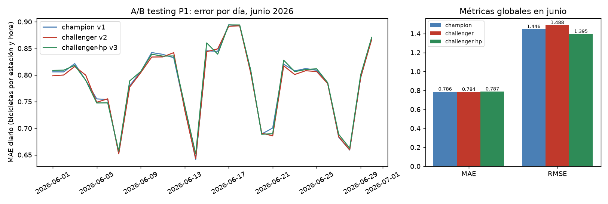

# A/B testing de P1 (demanda): champion vs. dos alternativas

Reproducir (requiere el servidor de MLflow del README principal y `MLFLOW_TRACKING_URI`):

```
python -m mibici_mlops_module.modeling.ab_testing             # registra v2 y v3, compara y guarda el reporte
python -m mibici_mlops_module.modeling.ab_testing --promover  # además mueve el alias champion si gana una
```

## Versiones

Modelo registrado: `mibici-equipo04-p1-demanda`. Cada alternativa cambia **un solo factor** respecto al champion,
para saber qué aporta cada cambio.

| Versión | Alias | Datos de entrenamiento | Hiperparámetros | Factor que cambia |
| --- | --- | --- | --- | --- |
| v1 | `champion` | ene – abr 2026 | HistGradientBoosting Poisson, `base` | referencia |
| v2 | `challenger` | ene – may 2026 | los mismos de v1 | datos más recientes (Continuous Training) |
| v3 | `challenger-hp` | ene – abr 2026 | `lento-lr0.05` del YAML (lr 0.05, 500 iteraciones, 31 hojas, L2 0.2) | configuración del modelo |

Junio no entra al entrenamiento de ninguna versión: es el conjunto de evaluación de las tres. Si alguna lo hubiera
visto, el A/B estaría contaminado.

## Resultados sobre el mismo conjunto: junio 2026 (279,312 filas)

| Versión | MAE | RMSE | MAE vs. v1 | RMSE vs. v1 | Días con menor error que v1 |
| --- | --- | --- | --- | --- | --- |
| v1 champion | 0.7859 | 1.4464 | | | |
| v2 challenger | 0.7840 | 1.4885 | −0.25 % | **+2.9 %** | 20 de 30 |
| v3 challenger-hp | 0.7873 | 1.3951 | +0.17 % | −3.5 % | 11 de 30 |

Intervalo de confianza de 95 % (bootstrap sobre los 30 días) de la diferencia diaria de MAE, v1 menos alternativa:
v2 [+0.0002, +0.0037] (la diferencia es pequeña pero consistente); v3 [−0.0032, +0.0006] (incluye el 0, es decir, no
hay diferencia demostrable).



Datos completos: `resultados.json` y `mae_por_dia.csv`. El MAE de v3 (0.78726) coincide con el que obtuvo en la
búsqueda de hiperparámetros (`P1-demanda-hist-gradient-boosting-poisson-lento-lr0.05`), lo que confirma que la
evaluación reproduce el entrenamiento.

## Decisión: se queda v1 como `champion`

Regla fijada antes de comparar: una alternativa reemplaza a v1 solo si (a) baja el MAE, la métrica con la que el
proyecto elige modelos, (b) su RMSE no empeora más de 1 % y (c) el IC 95 % de la diferencia diaria de MAE excluye el 0.

| | (a) baja MAE | (b) RMSE no empeora > 1 % | (c) IC excluye 0 | Resultado |
| --- | --- | --- | --- | --- |
| v2 | sí | **no** (+2.9 %) | sí | no gana |
| v3 | **no** (+0.17 %) | sí (−3.5 %) | **no** | no gana |

Ninguna alternativa supera a v1 en ambas métricas; cada una intercambia una por la otra:

- **v2 (más datos)** baja el MAE un 0.25 %, pero empeora el RMSE, es decir, falla más en los picos de demanda,
  que es donde Operaciones más necesita acertar para evitar estaciones vacías.
- **v3 (hiperparámetros)** reduce el RMSE un 3.5 %, o sea, acierta mejor en los picos, a cambio de un MAE
  0.17 % mayor que no se distingue del ruido. Es la mejor candidata si Operaciones llegara a priorizar los picos
  sobre el error típico; con el criterio actual del proyecto (MAE) no justifica el cambio.
- Ambos efectos son pequeños (menos de 0.3 % en MAE), consistente con que el drift de entrada es leve (ver
  [../drift/README.md](../drift/README.md)).

## Recomendación sobre Continuous Training

**No conviene automatizar un reentrenamiento por ahora.**

- El drift de junio es leve (2 de 12 variables de P1, una de calendario y otra apenas sobre el umbral) y **no explica
  el aumento de error**: el análisis por tramos de `salidas_media_24h` muestra que menos del 2 % del aumento del MAE
  de mayo a junio viene del cambio de la entrada.
- Reentrenar con un mes más de datos (v2) no mejoró el modelo en ambas métricas, y cambiar la configuración (v3)
  tampoco. El costo de reentrenar no se compensa.
- La mayor parte del aumento del MAE (0.721 a 0.786) es de escala: la demanda media subió 7.6 % y el MAE relativo
  (MAE / demanda media) solo subió 1.3 %.

Sí conviene mantener el monitoreo y revisar el modelo (con un reentrenamiento como el de v2) cuando ocurra alguno
de estos casos. Los umbrales son una propuesta del equipo, no están calibrados con más de un periodo:

1. Más de la mitad de las variables de entrada de P1 con drift en Evidently, o `salidas_media_24h` con distancia > 0.2.
2. El MAE relativo semanal (MAE / demanda media), medido sobre datos con resultado observado, supera en más de 10 %
   al de validación (0.649). Se usa el relativo para no confundir más demanda con peor modelo.
3. Se incorpora una temporada nueva completa o hay un cambio de la red (estaciones nuevas, cambio de tarifas).

Cuando se dispare alguno, el flujo es el de este módulo: entrenar las alternativas, compararlas en el periodo más
reciente y promover solo si cumplen la regla de decisión.

## Limitaciones

- Solo P1. P2 (riesgo) y P3 (tipología) no se reentrenaron.
- La evaluación es un A/B **offline** sobre junio: todas las versiones predicen las mismas filas. No hay tráfico
  dividido en producción (la API no registra peticiones).
- Dos alternativas exploran dos factores por separado; no se probó combinarlos (más datos e hiperparámetros distintos).
