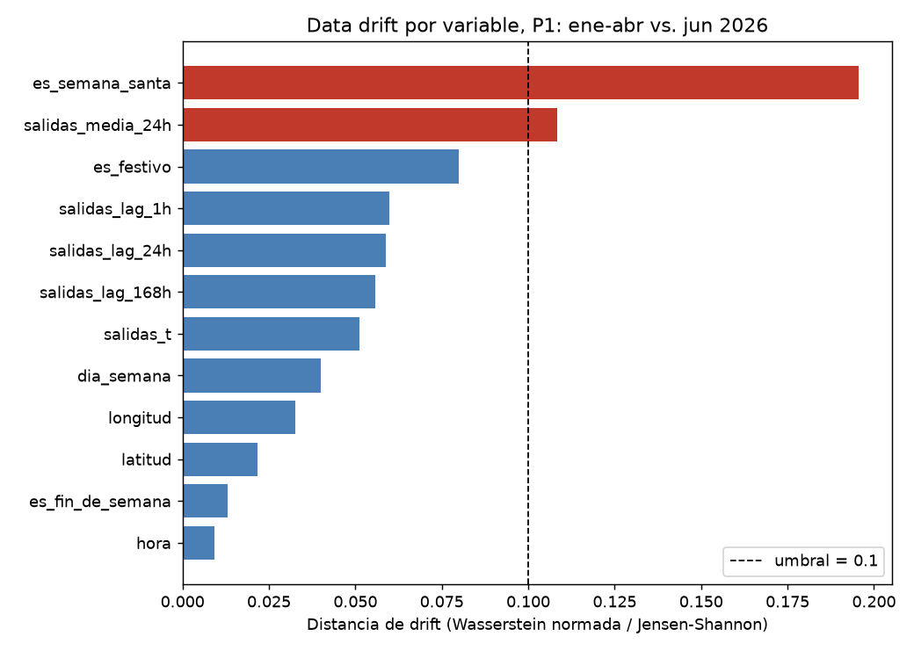
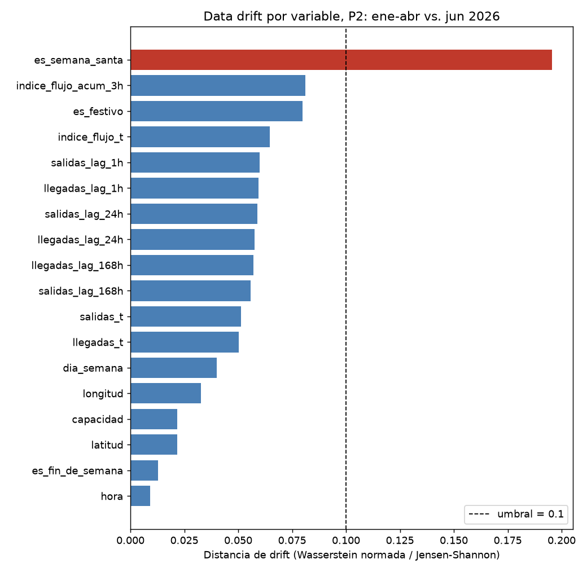
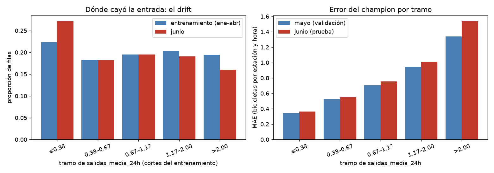

# Monitoreo de data drift (Evidently)

Reproducir: `python -m mibici_mlops_module.monitoreo` (≈15 s). Genera `drift_p1.html|json` y `drift_p2.html|json`
en esta carpeta; el `.html` se abre directo en el navegador.

## Conjuntos de datos

| Conjunto | Periodo | Filas (tabla P1/P2) | Origen |
| --- | --- | --- | --- |
| **Referencia** | 7 ene – 30 abr 2026 | 999,024 | `conjunto == "entrenamiento"`: los datos con los que se entrenaron los modelos |
| **Actual** | 1 – 30 jun 2026 | 279,312 | `conjunto == "prueba"`: el mes posterior más reciente de los datos abiertos de MiBici |

**Por qué estos periodos**

- La referencia es exactamente el periodo de entrenamiento, que es contra lo que el modelo "espera" que se parezcan
  los datos en producción.
- Como actual se eligió junio y no mayo porque (1) es el periodo más tardío disponible (los datos abiertos locales
  llegan a junio), (2) deja un mes completo de separación y (3) incluye un cambio de temporada real: inicio de lluvias
  y fin del ciclo escolar, lo que sí puede mover el uso de la bicicleta. Mayo ya se usó como validación.
- La API de la semana 8 no registra las peticiones que recibe, así que no hay tráfico real que usar; junio simula
  producción.
- Se compara el espacio de variables de entrada de cada modelo (`FEATURES_P1` y `FEATURES_P2` de `features.py`), no los
  objetivos. P3 (tipología) se excluye: es un perfil por estación sin dimensión temporal.
- Con ~1M vs. ~280k filas casi cualquier prueba estadística marca diferencias "significativas" por tamaño de muestra.
  Por eso se toma una muestra aleatoria de **50,000 filas por conjunto** (`random_state=42`).
- Calendario (`hora`, `dia_semana`, `es_*`) se trata como categórico; el resto como numérico.

## Configuración de Evidently (0.7.x)

`Report([DataDriftPreset(), DataSummaryPreset()])`: drift por variable (Wasserstein normalizado para numéricas y
Jensen-Shannon para categóricas, umbral 0.1) y calidad de datos (nulos, duplicados, columnas constantes, rangos y
estadísticos por variable).

## Resultados

| | P1 | P2 |
| --- | --- | --- |
| Variables con drift | 2 de 12 (16.7 %) | 1 de 18 (5.6 %) |
| Valores nulos | 0 | 0 |
| Filas duplicadas (en la muestra de 50k) | 327 | 1,779 |
| Columnas constantes | 2 | 2 |

Reportes completos de Evidently (interactivos): [P1](drift_p1.html) · [P2](drift_p2.html). Imágenes exportadas:

Variables con drift:

- `es_semana_santa` (JS = 0.196): efecto esperado del calendario. Existe en la referencia (30 mar – 10 abr) y no en
  junio, donde siempre vale 0. No indica un problema.
- `salidas_media_24h` en P1 (Wasserstein = 0.108, apenas sobre el umbral de 0.1): la actividad reciente cambió un poco
  entre periodos. Es la señal con más interés real.
- Cerca del umbral pero sin drift: `indice_flujo_acum_3h` (0.081) y `es_festivo` (0.080).
- El resto (ubicación, capacidad, salidas/llegadas y rezagos) quedó por debajo de 0.07.

Las 2 columnas constantes son `es_festivo` y `es_semana_santa`: en junio valen siempre 0 (no hay festivos oficiales ni
Semana Santa), cuando en la referencia sí varían. Es calendario, no un fallo de captura.

Las duplicadas son esperables (muchas estaciones-hora con valores enteros pequeños idénticos, p. ej. 0 salidas); no son
un error de datos.

## Implicaciones para el desempeño del modelo

Para saber si el drift importa se midió el error del modelo vigente con el objetivo observado
(`python -m mibici_mlops_module.modeling.drift_desempeno`; resultados en `desempeno.json`).

**P1 empeoró de mayo a junio, pero el drift de entrada casi no lo explica.** El MAE pasó de 0.721 (mayo, validación) a
0.786 (junio, prueba), un 9.0 % más. Todas las semanas de junio (0.77 a 0.83) quedan por encima de todas las de mayo
(0.72 a 0.73), así que no es un día atípico.

Para ver si el corrimiento de `salidas_media_24h` es la causa, se partió el error en cinco tramos de esa variable
(cortes del entrenamiento) y se separó el aumento del MAE en dos efectos:

| Efecto | Aumento de MAE | Parte del total (0.0652) |
| --- | --- | --- |
| Mezcla: junio tiene más filas en tramos que el modelo suele errar más (el drift) | +0.0010 | 1.5 % |
| Dentro de cada tramo: el modelo erra más aun con entradas del mismo tipo | +0.0642 | 98.5 % |

- El error subió **en los cinco tramos**, más en el de mayor actividad (> 2.00: de 1.34 a 1.54, +14.6 %). La entrada
  cambió poco; lo que cambió es cuánto se parece la demanda real a lo que predice el modelo para esa entrada.
- Gran parte de ese aumento es de **escala**: la demanda media subió 7.6 % (1.110 a 1.195 salidas por estación y
  hora) y el MAE relativo (MAE / demanda media) solo subió 1.3 % (0.649 a 0.658). Con más demanda hay más error
  absoluto aunque el modelo acierte proporcionalmente casi igual.
- Conclusión: el deterioro propio del modelo es pequeño (alrededor de 1.3 % relativo), pero sostenido semana a
  semana. Es compatible con un cambio de comportamiento de temporada (lluvias, fin del ciclo escolar), pero eso es
  una hipótesis: el análisis no lo demuestra.

**P2 empeoró levemente**, con las métricas que el entrenamiento guardó para mayo y junio:

| Métrica | Mayo | Junio |
| --- | --- | --- |
| Balanced accuracy | 0.702 | 0.683 |
| F1 macro | 0.427 | 0.419 |
| Recall de `vaciado` | 0.673 | 0.655 |
| Recall de `normal` | 0.729 | 0.732 |
| Recall de `saturacion` | 0.702 | 0.664 |

La caída se concentra en `saturacion` (−3.9 puntos de recall): el modelo deja de detectar más estaciones llenas, la
clase operativamente más costosa. Ninguna variable de P2 tuvo drift más allá de calendario, así que, igual que en P1,
el cambio no viene de la entrada.

**Variables de calendario:** `es_semana_santa` y `es_festivo` no afectan: en junio valen siempre 0, el valor
dominante en el entrenamiento.

## Limitaciones

- Es drift de variables de entrada; no mide degradación del desempeño del modelo (eso requiere el objetivo observado).
- El umbral 0.1 es el predeterminado de Evidently, no calibrado para MiBici.
## Interpretación de resultados de Data Drift (Punto 3)

> Esta interpretación parte solo de las distribuciones de las entradas. La medición con el objetivo observado está en [Implicaciones para el desempeño del modelo](#implicaciones-para-el-desempeño-del-modelo) y la comparación de versiones en [../ab_testing/README.md](../ab_testing/README.md).

### Análisis del modelo P1: Predicción de demanda

El modelo P1 presentó drift en 2 de sus 12 variables (16.7 %). La primera, `es_semana_santa`, registró una distancia Jensen-Shannon de 0.196, lo que se explica por las diferencias de calendario entre los periodos de entrenamiento y prueba. Este cambio no constituye, por sí mismo, evidencia de un problema en el modelo.

La segunda variable, `salidas_media_24h`, presentó una distancia Wasserstein normalizada de 0.108, ligeramente superior al umbral de 0.1. Este resultado indica una modificación en la distribución de la demanda reciente de bicicletas, que podría relacionarse con cambios estacionales y patrones de movilidad.

Esta variable merece especial atención porque representa el comportamiento reciente de uso del sistema y podría afectar la precisión de las predicciones. Sin embargo, para determinar si existe una degradación real, es necesario comparar métricas de desempeño como MAE y RMSE entre los periodos.

### Análisis del modelo P2: Predicción de riesgo

El modelo P2 presentó drift en 1 de sus 18 variables (5.6 %), correspondiente a `es_semana_santa`, con una distancia Jensen-Shannon de 0.196.

Este resultado se interpreta principalmente como un cambio esperado del calendario. Las variables `indice_flujo_acum_3h` (0.081) y `es_festivo` (0.080) permanecieron por debajo del umbral establecido.

Por lo tanto, los resultados no muestran un cambio generalizado en las variables de entrada del modelo P2. No obstante, la estabilidad de las distribuciones no garantiza que el desempeño predictivo permanezca constante.

### Implicaciones para los modelos

Los resultados sugieren que el modelo P1 requiere mayor seguimiento que P2, debido al cambio detectado en una variable relacionada directamente con la demanda reciente.

En ambos modelos, el drift asociado a Semana Santa debe interpretarse considerando el contexto temporal de los datos, evitando confundir cambios esperados del calendario con errores de captura o degradación del modelo.

El análisis realizado mide cambios en las distribuciones de las variables de entrada, pero no demuestra una pérdida de precisión predictiva.

### Recomendaciones

1. Mantener el monitoreo periódico de las variables de entrada mediante Evidently.
2. Priorizar el seguimiento de `salidas_media_24h` en P1 y verificar si su cambio persiste en nuevos periodos.
3. Comparar MAE y RMSE de P1 y las métricas de clasificación correspondientes a P2 utilizando datos etiquetados.
4. Evaluar el reentrenamiento únicamente si se confirma una degradación sostenida del desempeño.
5. Incorporar comparaciones entre periodos estacionales equivalentes para distinguir cambios esperados de anomalías relevantes.

### Conclusión

El monitoreo evidencia una estabilidad general de las variables de entrada de ambos modelos, con cambios puntuales asociados al calendario y al comportamiento reciente de la demanda.

Se recomienda mantener los modelos actuales bajo observación y priorizar la evaluación de desempeño de P1 antes de tomar decisiones de reentrenamiento. Esta recomendación es provisional y deberá complementarse con los resultados de las pruebas A/B.